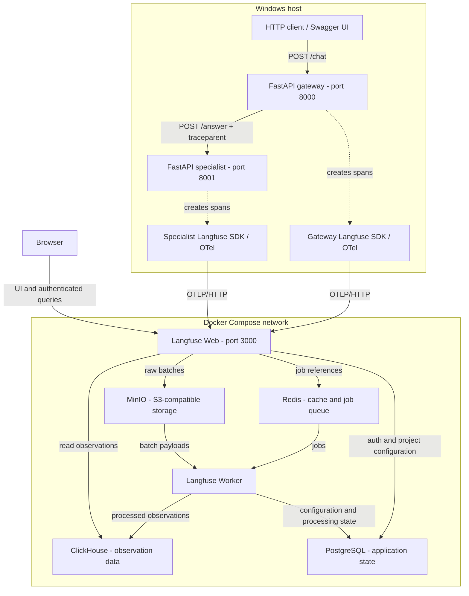
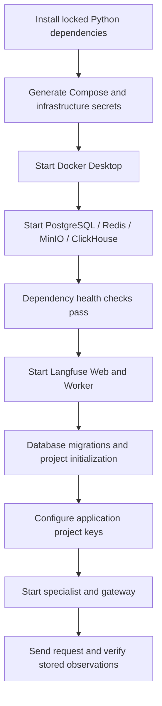
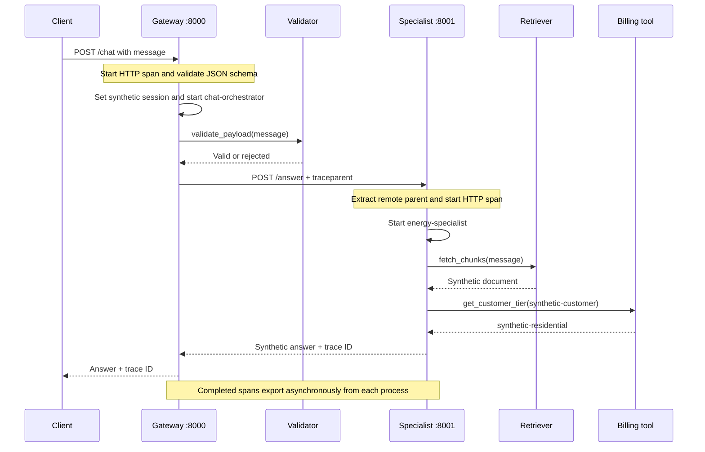
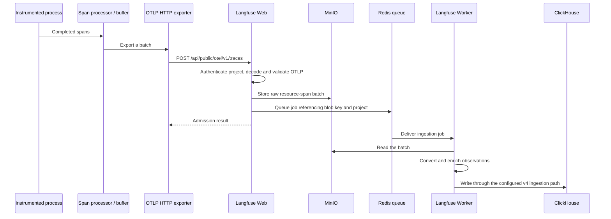
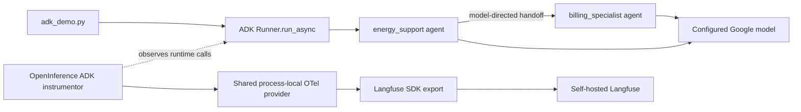

# LangFuse_Ignitis: architecture and ingestion walkthrough

Verified against the repository and local deployment on 8 November 2026.

Configuration and service setup were simplified on 9 November 2026. The request
and ingestion paths are the same; settings now come from `app/settings.py`.

Reference implementation for discussion with the Ignitis development team. The
workflow and data are synthetic; the target production topology remains to be
confirmed. Verification statements below describe that dated local deployment.

This guide follows a request from the HTTP entry point to its stored observations.
It also explains what must change when connecting the actual energy-provider chatbot.

## Contents

1. [What is running](#1-what-is-running)
2. [Terms used throughout this guide](#2-terms-used-throughout-this-guide)
3. [Components and dependencies](#3-components-and-dependencies)
4. [Bootstrap and startup order](#4-bootstrap-and-startup-order)
5. [A chat request, step by step](#5-a-chat-request-step-by-step)
6. [How context crosses service boundaries](#6-how-context-crosses-service-boundaries)
7. [How telemetry reaches storage](#7-how-telemetry-reaches-storage)
8. [How the dashboard reads the data](#8-how-the-dashboard-reads-the-data)
9. [The separate ADK execution path](#9-the-separate-adk-execution-path)
10. [Data capture and evaluation ingestion](#10-data-capture-and-evaluation-ingestion)
11. [Failure behavior and delivery guarantees](#11-failure-behavior-and-delivery-guarantees)
12. [Connecting the actual system](#12-connecting-the-actual-system)
13. [Verification and troubleshooting](#13-verification-and-troubleshooting)
14. [Source map and references](#14-source-map-and-references)

## 1. What is running

The reference deployment uses two Python service processes on Windows and six
Linux containers in Docker Desktop. The Python services execute the demonstration workflow. The
containers receive, process, store and display its telemetry.



The diagram separates two flows:

- **Application execution:** the client calls the gateway, which calls the specialist.
- **Telemetry ingestion:** each service exports its own observations to Langfuse.

The specialist's answer returns through the gateway. It does not travel through
Langfuse. Langfuse receives descriptions of the work as telemetry.

### Scope of the current implementation

| Capability | Current state |
| --- | --- |
| Two separate FastAPI processes | Exercised in the local verification |
| One trace across both processes | Verified in stored observations |
| Guardrail, retriever and billing tool observations | Implemented and ingested |
| Actual model calls in the FastAPI flow | None; responses are deterministic |
| Real vector database or customer billing integration | None; functions return synthetic values |
| Actual ADK multi-agent example | Implemented separately; imports and agent construction checked |
| Real ADK model execution | Requires a Google key; not executed during local setup |
| Custom evaluation results | No evaluator or score ingestion implemented yet |
| Real Ignitis/GCP integration | Requires access to the actual services and deployment details |

The `agent` observation type labels a traced operation. Applying it to a Python
function does not turn that function into a model-driven agent.

## 2. Terms used throughout this guide

| Term | Meaning here |
| --- | --- |
| Trace | Related operations sharing one trace ID, normally for one request/turn |
| Span | One timed operation with an ID, optional parent ID, attributes and status |
| Observation | Langfuse's representation of a span, with types such as `agent`, `tool`, `retriever` or `guardrail` |
| Active context | The request-local OTel state from which new operations inherit their parent |
| Tracer provider | The process-local OTel object that creates tracers and owns processing/export configuration |
| Instrumentation | Code that creates observations automatically or through explicit decorators |
| Span processor | Receives span lifecycle notifications; the batching processor buffers completed spans for export |
| Exporter | Sends telemetry to a backend using a defined protocol |
| OTLP | OpenTelemetry's transport format; this setup uses traces over HTTP/protobuf |
| Baggage | Separately propagated contextual key/value data; traceparent alone does not carry it |
| Session ID | An application-level identifier grouping multiple turns of a conversation |
| Score | A quality/evaluation result attached to the relevant Langfuse entity |

A trace ID identifies a request's related work. A span ID identifies one operation.
A session ID groups conversation turns. These identifiers serve different purposes.

## 3. Components and dependencies

### 3.1 Application services

| Component | Source | Responsibility |
| --- | --- | --- |
| Gateway | [`app/gateway.py`](app/gateway.py) | Validate the request, run the demonstration guardrail, call the specialist, return the answer and trace ID |
| Specialist | [`app/specialist.py`](app/specialist.py) | Run retrieval and billing demonstrations and return a synthetic response |
| Components | [`app/components.py`](app/components.py) | Named observations for validation, knowledge retrieval and billing lookup |
| Shared tracing setup | [`app/telemetry.py`](app/telemetry.py) | Load environment settings, initialize Langfuse, instrument FastAPI, inject trace headers and shut down tracing |
| Settings | [`app/settings.py`](app/settings.py) | Validate configuration once with Pydantic BaseSettings; load `.env` without modifying process environment variables |
| Message models | [`app/models.py`](app/models.py) | Share request validation and the expected response shape between both services |
| ADK example | [`examples/adk_demo.py`](examples/adk_demo.py) | Run a root agent and billing sub-agent with automatic ADK instrumentation |

`Uvicorn` serves each FastAPI application. `Pydantic` validates its JSON payload.
`httpx` makes the gateway's outbound HTTP request. The `langfuse` SDK creates typed
observations and configures OTel export. FastAPI's OTel instrumentation creates
HTTP server/ASGI spans and extracts incoming trace context.

There is no HTTPX auto-instrumentor in this repository. The gateway explicitly
injects trace context, so there is no separate automatically created HTTP client
span between `chat-orchestrator` and the specialist's server span.

### 3.2 Langfuse services and persistence

| Service | Role in this deployment | Why it exists |
| --- | --- | --- |
| Langfuse Web | UI, public API, authenticated telemetry entry point | Applications need an ingest endpoint; users need a query interface |
| Langfuse Worker | Asynchronous ingestion and background jobs | Processing and storage work can run independently of HTTP admission |
| PostgreSQL | Users, organizations, projects, credentials/configuration and other transactional state | Relational application state is different from large analytical trace datasets |
| ClickHouse | Analytical observation/score data | Trace searches and aggregations operate over this store |
| Redis | Job queues and caches | Connects ingestion to workers and caches frequently used data |
| MinIO | S3-compatible raw ingestion batches and other blob data | Keeps large payloads outside Redis and supplies the worker with batch contents |

These roles follow Langfuse's [self-hosted architecture](https://langfuse.com/self-hosting).
For storage-specific behavior, see the official
[ClickHouse](https://langfuse.com/self-hosting/deployment/infrastructure/clickhouse),
[PostgreSQL](https://langfuse.com/self-hosting/deployment/infrastructure/postgres)
and [blob storage](https://langfuse.com/self-hosting/deployment/infrastructure/blobstorage)
guides.

The upstream Compose file also defines `langfuse-ai-gateway`. It is **not started**
by the README's six-container deployment command. That optional model proxy is a different
component from our `app/gateway.py` FastAPI service.

### 3.3 Addresses and network boundaries

All published container ports and both demonstration APIs bind to the local host.

| Component | Windows-side address | Address used between containers |
| --- | --- | --- |
| Application gateway | `http://127.0.0.1:8000` | Runs outside Docker |
| Application specialist | `http://127.0.0.1:8001` | Runs outside Docker |
| Langfuse Web | `http://localhost:3000` | `http://langfuse-web:3000` |
| Langfuse Worker | `127.0.0.1:3030` | `langfuse-worker:3030` |
| PostgreSQL | `127.0.0.1:5432` | `postgres:5432` |
| Redis | `127.0.0.1:6379` | `redis:6379` |
| ClickHouse HTTP/native | `127.0.0.1:8123` / `127.0.0.1:9000` | `clickhouse:8123` / `clickhouse:9000` |
| MinIO object API | `http://127.0.0.1:9090` | `http://minio:9000` |
| MinIO console | `http://127.0.0.1:9091` | `http://minio:9001` |

`localhost` refers to the caller's own network namespace. The Windows Python
processes reach Langfuse using published port 3000. The web/worker containers
reach their databases by Compose service names. A container configured with
`localhost:5432` would look for PostgreSQL inside that container.

### 3.4 Versions and reproducibility

The Python environment used for the recorded verification contained:

| Package | Installed version |
| --- | --- |
| Python | 3.12.14 |
| `langfuse` | 4.18.0 |
| `fastapi` / `uvicorn` | 0.162.2 / 0.54.0 |
| `httpx` / `pydantic` | 0.28.1 / 2.14.3 |
| `opentelemetry-api` / `opentelemetry-sdk` | 1.45.2 / 1.45.2 |
| `opentelemetry-instrumentation-fastapi` | 0.66b2 |
| `opentelemetry-exporter-otlp-proto-http` | 1.45.2 |
| `google-adk` / `google-genai` | 2.14.0 / 2.34.0 |
| `openinference-instrumentation-google-adk` | 0.1.28 |
| `python-dotenv` | 1.2.4 |

`pyproject.toml` declares acceptable version ranges; `uv.lock` resolves the exact
dependency graph. `uv sync --locked --all-extras` includes the optional ADK packages.
Base dependencies suffice for the synthetic FastAPI example.

The setup script pins Langfuse web/worker images to `4.76.0` and downloads Compose
from upstream commit `02fb648b58df0b22578b5d5f10b2bb61c39e0486`.
The generated file uses ClickHouse `26.3.62.3`, PostgreSQL `17`, Redis `7` and
`cgr.dev/chainguard/minio`. The latter three image references are not immutable
digest pins; repeating an image pull later can retrieve a different build.

## 4. Bootstrap and startup order



### 4.1 Infrastructure setup

[`scripts/setup_langfuse.py`](scripts/setup_langfuse.py) downloads the upstream
Compose file, binds the relevant exposed services to loopback, generates random
infrastructure secrets, and writes the result under `infra/.runtime/`.

PostgreSQL's password and `DATABASE_URL` must agree. MinIO's root password and
the S3 upload secret settings must agree. Web and worker share connection settings
through the Compose environment anchor. Generating unrelated values for each
side of a connection would break authentication.

The script refuses to overwrite an existing runtime setup. Its rerun message
means the existing files were preserved; it is not a running-service check.

### 4.2 The two environment files

| File | Consumer | Main contents |
| --- | --- | --- |
| `.env` at repository root | `Settings`, through Pydantic BaseSettings | Langfuse URL, project API keys, environment, specialist URL and optional model key |
| `infra/.runtime/.env` | Docker Compose | Database/object-store secrets, image tag, server settings and local headless initialization values |

Compose interpolates the infrastructure `.env` into its container configuration.
The Python application reads the root `.env` separately. Editing one file does
not automatically update the other or change the environment of an already
running process.

`get_settings()` caches validated settings for each process. Environment variables
take precedence over the root `.env`; optional blank values use their defaults.
Missing project keys or malformed settings fail during startup. URLs and the
specialist timeout are validated, and secret values are masked in the settings
representation. The SDK receives explicit configuration instead of depending on
`load_dotenv()` to populate its environment. Each service supplies its own default
name; `OTEL_SERVICE_NAME` can override it.

`LANGFUSE_PUBLIC_KEY` and `LANGFUSE_SECRET_KEY` identify the destination project.
They are not the UI user's email/password and are not PostgreSQL credentials.

`TELEMETRY_ENABLED=false` in the infrastructure file disables Langfuse's own
deployment telemetry setting. Our application's trace export is controlled
separately by its SDK configuration, including `LANGFUSE_TRACING_ENABLED`.

### 4.3 Project and login initialization

Follow the README to sign up, create an organization/project, and copy that
project's keys into the root `.env`. Each developer creates their own local
account and project; the repository supplies no predefined login credentials.

For automated provisioning, Langfuse also accepts `LANGFUSE_INIT_*` settings for
the organization, project, API keys and initial user. Supply these through the
infrastructure environment before first initialization and keep their values
outside Git. The setup script does not populate these optional settings.
Langfuse documents the required variables under
[headless initialization](https://langfuse.com/self-hosting/administration/headless-initialization).

### 4.4 Python process initialization

Each Uvicorn process imports its application module, which calls the shared
`create_app()` in `app/telemetry.py`. The setup then:

1. Loads and validates the process settings through `get_settings()`.
2. Reuses the global OTel provider, or registers one with the service's name.
3. Initializes Langfuse with explicit project keys, URL, environment and that provider.
4. Adds the SDK span processing/export path through Langfuse.
5. Instruments FastAPI with that same provider.
6. Registers shutdown behavior through FastAPI's lifespan context.

`get_client()` retrieves the configured project client. It does not create a
network connection or new exporter for every decorated function call.

The two OS processes have separate providers and export buffers. Sharing a
provider means sharing it **within a process**. Cross-process continuity comes
from HTTP context propagation, not from sharing a Python object.

## 5. A chat request, step by step



### Step 1: receive and validate the HTTP payload

FastAPI instrumentation wraps `POST /chat` in a server span. If there is no valid
incoming trace context, the tracing system creates a new trace.

Pydantic requires a `message` string of at most 4,000 characters. A schema failure
can reject the request before `chat-orchestrator` or the custom validator runs.
Schema validation and the demonstration guardrail are separate steps.

### Step 2: add request attributes and enter the orchestrator

The route enters `propagate_attributes(...)` with a fresh UUID session and the
tags `synthetic` and `energy-support`. The async `orchestrate()` decorator starts
the `chat-orchestrator` observation beneath the HTTP span.

The decorator records the operation's lifecycle and type. Arguments and return
values are not automatically captured here because both capture flags are false.

### Step 3: execute the guardrail

`validate_payload()` runs inside an `input-validator` observation. It rejects
whitespace-only input or text containing `drop table`, ignoring case.

A rejection sets that observation to `WARNING` with `Blocked input`. The
orchestrator then raises HTTP 422 and makes no specialist request. The keyword
rule is only a demonstration; it is not a production security mechanism.

### Step 4: call the specialist

The gateway builds an HTTP request to `SPECIALIST_URL + /answer`, with the
`SPECIALIST_TIMEOUT_SECONDS` setting (ten seconds by default).
`outbound_headers()` injects the currently active
trace context. The specialist receives the text in its JSON body and the parent
relationship in its HTTP headers.

The timeout applies to HTTPX's configured network-operation phases; this code
does not implement a separate end-to-end request deadline or retry policy.

### Step 5: execute retrieval and billing work

The specialist's HTTP instrumentation creates a server span linked to the
remote parent. Its `answer()` decorator starts `energy-specialist` beneath it.

The specialist awaits the retriever and then the billing tool **sequentially**:

1. `vector-db-lookup` returns a synthetic FAQ document and sets metadata
   `db=synthetic` and `hits=1` with the default `top_k`.
2. `billing-lookup` returns `synthetic-residential` for a fixed synthetic identifier.

No Qdrant database, embedding API, customer database or billing backend is called.
The fetched chunks and tier do not currently influence the fixed response text.

### Step 6: return the result

The specialist returns its answer and current trace ID. The gateway checks the
HTTP response status and returns the JSON, setting `trace_id` to its own current
trace ID. Our stored-span verification independently confirmed both services
belonged to that same trace.

The client receives a successful answer before every telemetry batch necessarily
becomes visible in Langfuse.

Both services now use shared `ChatRequest` and `ChatResponse` models from
`app/models.py`. The gateway also validates the specialist's response, returning
a sanitized HTTP 502 for invalid JSON or an unexpected response shape.

### Step 7: close observations

The async decorators close their observations as the functions return. FastAPI
instrumentation also records ASGI receive/send operations and closes the HTTP
server spans. Closing a span makes it available for batch export.

## 6. How context crosses service boundaries

### 6.1 Inside a process

An active OTel context follows the async call chain. Nested observed functions
inherit the active parent. Concurrent request tasks therefore have independent
current contexts when used through these normal async calls.

This is why `billing-lookup` is a child of `energy-specialist`, rather than a
separate trace. The tests exercise three concurrent requests and check isolation.

### 6.2 Across HTTP

The current helper uses `TraceContextTextMapPropagator`. An illustrative header
with example identifiers is:

```text
traceparent: 00-0123456789abcdef0123456789abcdef-0123456789abcdef-01
                trace ID                         parent span ID    flags
```

The fields are a version, a 32-hex-character trace ID, a 16-hex-character parent
span ID, and trace flags. A recipient continues the trace using those IDs.
This propagation mechanism is described in the
[OpenTelemetry context guide](https://opentelemetry.io/docs/concepts/context-propagation/).

Here the active parent at injection is `chat-orchestrator`, because no HTTPX
client span is created. If HTTPX instrumentation is added, that client span can
become the immediate parent instead; the overall trace remains the same.

### 6.3 Trace identity and session metadata currently differ

The helper injects W3C trace context. It does **not** serialize the Langfuse
session ID or tags. `propagate_attributes()` also defaults to `as_baggage=False`
in the installed SDK.

The verified backend data shows:

| Observations | Trace ID shared? | Session ID present? |
| --- | --- | --- |
| Gateway HTTP root, orchestrator and guardrail | Yes | Yes |
| Specialist HTTP span, agent, retriever and tool | Yes | No |
| Some gateway ASGI child spans | Yes | No; created outside the attribute scope |

Consequently, selecting the trace shows the connected work. Filtering every
observation by the session ID can omit downstream work. These are different
operations in an observation-oriented backend.

For the actual system, put approved conversation attributes into the context
early enough and propagate them through an explicit contract. Options include
Langfuse's supported baggage mode together with configured baggage injection/
extraction, or allowlisted application headers with downstream attribute setup.
Changing `as_baggage` alone will not fix this helper, which currently injects only
trace context. Avoid forwarding arbitrary inbound baggage to third parties.

The current route generates a new session per request. To group a conversation,
use a stable, approved conversation ID across its turns and distinct trace IDs
for the separate turns.

### 6.4 The observed span tree

The successful synthetic request produced this stored hierarchy:

```text
POST /chat                                    HTTP server
|-- POST /chat http receive                    ASGI
|-- chat-orchestrator                          AGENT
|   |-- input-validator                       GUARDRAIL
|   `-- POST /answer                          HTTP server in another process
|       |-- POST /answer http receive          ASGI
|       |-- energy-specialist                 AGENT
|       |   |-- vector-db-lookup               RETRIEVER
|       |   `-- billing-lookup                 TOOL
|       |-- POST /answer http send             ASGI response start
|       `-- POST /answer http send             ASGI response body
|-- POST /chat http send                       ASGI response start
`-- POST /chat http send                       ASGI response body
```

That is 13 observations for this particular request. The count can change with
middleware, framework versions, streaming and filtering. It is not a fixed
number that every chat must produce.

Both service entry spans were marked `isRootObservation=true` by the ingestion
result, while the specialist still retained its remote `parentObservationId`.
Use trace IDs and parent IDs to inspect distributed ancestry; do not interpret
that flag alone as proof of a disconnected trace.

## 7. How telemetry reaches storage



### 7.1 Instrumentation to the local export buffer

`@observe` creates typed SDK observations. FastAPI instrumentation creates generic
HTTP spans. Both feed the same process-local provider.

`Langfuse(should_export_span=lambda span: True)` accepts all spans that reach its
export-filter decision, rather than restricting the view to AI observations.
This makes HTTP boundaries visible and also includes low-level ASGI noise.

That filter is not an instruction to instrument every library: uninstrumented
operations still create no spans. The `/health` URLs are excluded from FastAPI
instrumentation in this project.

The SDK batches completed spans in memory using time and batch-size thresholds.
The application does not call `flush()` after each HTTP request. See Langfuse's
[batching guide](https://langfuse.com/docs/observability/features/queuing-batching).

### 7.2 Buffer to Langfuse Web

Inspection of installed SDK 4.18.0 confirms the default destination:

```text
LANGFUSE_BASE_URL + /api/public/otel/v1/traces
```

For our host processes this is
`http://localhost:3000/api/public/otel/v1/traces`. The exporter serializes an OTLP
protobuf request. Project authentication uses HTTP Basic authentication with
the project public/secret key pair; it also supplies SDK identity/version headers.

The browser never needs that secret key. Applications should export server-side.
The application does not send spans directly to PostgreSQL, Redis or ClickHouse.

An OTel Collector is optional and is not present here. The SDK exports directly
to Langfuse. A future collector could centralize routing, processing or buffering,
but would add its own deployment and delivery behavior to verify.

### 7.3 HTTP admission and validation

In Langfuse 4.76.0, the
[OTLP route](https://github.com/langfuse/langfuse/blob/v4.76.0/web/src/pages/api/public/otel/v1/traces/index.ts)
authenticates the request to a project, handles body limits/decompression, and
passes it to the ingestion processor. Invalid input is rejected before normal
worker processing.

The
[request processor](https://github.com/langfuse/langfuse/blob/v4.76.0/web/src/server/otel/processOtelIngestion.ts)
decodes the supported payload format and checks span IDs and collection shapes.
This endpoint accepts traces; directing an OTel log exporter at it is not a way
to ingest application logs.

### 7.4 Raw storage and queueing

The
[OTel ingestion processor](https://github.com/langfuse/langfuse/blob/v4.76.0/packages/shared/src/server/otel/OtelIngestionProcessor.ts)
stores the batch in blob storage before enqueueing its processing job. Here the
blob service is MinIO. The key is under the configured event prefix and includes
the project, time partition and a random identifier.

The Redis job carries a blob reference, project/authentication context and
ingestion attribution. Redis therefore need not hold the full trace payload.
HTTP acceptance indicates admission into this pipeline, not completion of every
downstream storage/query step.

The
[queue definition](https://github.com/langfuse/langfuse/blob/v4.76.0/packages/shared/src/server/redis/otelIngestionQueue.ts)
uses BullMQ with six attempts and exponential retry backoff beginning at five
seconds for the primary ingestion queue. Those settings concern worker jobs;
they are distinct from SDK exporter retries and application request retries.

### 7.5 Worker conversion and storage

The worker reads the stored batch, prepares its resource spans and maps their
IDs, timing, types, statuses and attributes into the Langfuse representation.
It can enrich model usage/cost fields when the necessary telemetry and model
information are available. Our synthetic flow supplies no model usage.

Relevant upstream implementation:
[queue consumer](https://github.com/langfuse/langfuse/blob/v4.76.0/worker/src/queues/otelIngestionQueue.ts)
and [event processing](https://github.com/langfuse/langfuse/blob/v4.76.0/worker/src/features/otel-ingestion/processOtelEvents.ts).

Langfuse v4 distinguishes its observations/events write path from compatibility
processing of older ingestion formats. Current Langfuse SDK versions qualify for
the current path through SDK attribution. Custom OTel exporters should use the
documented `x-langfuse-ingestion-version: 4` setting. See
[version compatibility](https://langfuse.com/self-hosting/upgrade/versioning).

The term "direct" v4 write refers to the worker's selected persistence path.
It does not mean our Python process bypasses Langfuse Web, Redis, blob storage or
the worker. This distinction is visible in the 4.76.0 source cited above.

### 7.6 What persists, and where

Compose mounts named volumes for PostgreSQL, Redis, ClickHouse data/logs and
MinIO data. These outlive container recreation and a normal `docker compose down`.
Removing volumes is a separate operation that can delete the saved local state.

SDK buffers, active request contexts and the ADK example's in-memory sessions
are not persisted in those volumes. They belong to the Python process.

## 8. How the dashboard reads the data

1. A user signs in to Langfuse Web using the UI account.
2. The server checks the user's project access against its application state.
3. The UI or public query API requests observations with filters such as trace ID.
4. The server queries the analytical store and returns observation records.
5. The UI displays relationships using the shared trace ID and parent observation IDs.

For verification we used the installed SDK's Observations API v2 wrapper:

```python
from app.telemetry import setup_tracing

client = setup_tracing("trace-inspector")
response = client.api.observations.get_many(
    trace_id="replace-with-trace-id-returned-by-chat",
    limit=100,
)
for observation in response.data:
    print(observation.name, observation.id, observation.parent_observation_id)
client.shutdown()
```

This reads stored data rather than merely trusting that the SDK exported it.
The code selects the first page; use API pagination when a real trace exceeds
the requested limit. Eventual visibility involves SDK batching, admission,
worker processing, storage flushes and query behavior.

## 9. The separate ADK execution path

`examples/adk_demo.py` is a command-line example. The FastAPI `/chat` endpoint does
not currently invoke it.



The script loads settings, verifies the Langfuse credentials, and instruments ADK
using the same provider as the SDK. It constructs the agents, creates an
`InMemorySessionService` session and runs an async event loop beneath an explicit
`adk-energy-chat` observation.

Unlike the deterministic FastAPI workflow, the root agent can call a model and
choose a handoff to its billing sub-agent. The instrumentor observes supported
agent/model/tool execution points. The model's behavior controls the exact tree.

Using `run_async()` keeps the call in the current async execution context.
The script prints final text events and the trace URL, then shuts down the client
so ended spans can be exported. Agent definitions and prompts are in the source;
they are not currently fetched from Langfuse prompt management.

This follows the official
[ADK integration](https://adk.dev/integrations/langfuse/) and
[Langfuse ADK example](https://langfuse.com/integrations/frameworks/google-adk).

For FastAPI integration, construct the runner/session dependency at an appropriate
application lifecycle boundary, call it under the request context, and use an
approved persistent session strategy. Do not call `shutdown()` after every turn
in a long-lived API; the current lifespan shutdown is process-level.

The example uses Google API-key access. Vertex identity, Agent Engine deployment,
streaming responses and production session persistence have not been integrated.

## 10. Data capture and evaluation ingestion

### 10.1 What the synthetic path exports

| Data | Current behavior |
| --- | --- |
| Operation names/types, times and parent IDs | Captured |
| Guardrail warnings and dependency errors | Set on the relevant observations |
| Retrieval metadata | Explicitly sets synthetic backend name and hit count |
| Function argument/return capture | Disabled for all five named demonstration components |
| HTTP telemetry | Created by FastAPI instrumentation; custom request-header capture is empty |
| Customer identifiers | No actual customer integration; billing input is a fixed synthetic value |
| Session and tags | Set in the gateway's attribute scope, with the propagation limits described earlier |
| Model prompts, usage and cost | No model in this path, so none is produced |

Disabling decorator input/output capture does not globally sanitize all telemetry.
Other instrumentors, URL fields, metadata and exception events have their own
capture behavior. The ADK instrumentor can capture model payloads independently.
Before using customer data, inspect the actual exported attributes and apply
redaction before export. Langfuse documents
[masking hooks](https://langfuse.com/docs/observability/features/masking) for this purpose.

### 10.2 Evaluation ingestion is an additional flow

The current repository does not submit quality scores. A trace with timings says
what happened; it does not establish whether an answer was correct.

A proposed integration for existing custom runners is:

```text
conversation / dataset case
    -> execute the chatbot and retain its trace/observation identifiers
    -> run the custom evaluator on the approved input/output/reference
    -> produce a named score and evaluator version
    -> submit it to Langfuse against the intended target
    -> inspect quality alongside latency and failures
```

Keep evaluator identity, version, score meaning and target IDs explicit. Account
for retried jobs so the same evaluation is not accidentally counted repeatedly.
Use a compatible SDK/API with suitable score identifiers for that design.

The custom runner can remain outside Langfuse initially; submitting scores does
not migrate its execution environment. Running evaluators inside Langfuse,
creating datasets and running offline experiments are later integration choices.
See [scores via API/SDK](https://langfuse.com/docs/evaluation/evaluation-methods/scores-via-sdk).

## 11. Failure behavior and delivery guarantees

| Failure or condition | Current effect | Where to investigate |
| --- | --- | --- |
| Invalid JSON or oversized message field | FastAPI/Pydantic rejects the request | HTTP response and gateway server observation |
| Keyword guardrail rejection | HTTP 422, warning on validator, no specialist call | `input-validator` and orchestrator |
| Specialist network error, timeout or non-success status | Gateway returns 502 and records `Specialist unavailable` | Gateway observation, specialist process and network |
| Missing/malformed specialist JSON | Gateway validates it and returns a sanitized 502 | Gateway error observation |
| Missing project keys | Settings validation fails during startup | Set the two project keys in `.env` or the environment |
| Incorrect project keys | Export authentication can fail | Python SDK logs and project settings |
| Langfuse temporarily unavailable | Export attempts can fail while application work can still succeed | Exporter logs; do not infer ingestion from HTTP 200 on `/chat` |
| Worker stopped | Admitted work can remain queued until processing resumes | Redis queue, worker logs and raw batches |
| Blob storage unavailable | Ingestion admission or worker batch reads can fail | MinIO connectivity, credentials and web/worker logs |
| ClickHouse unavailable | Persistence/query failures or growing processing backlog | Worker, ClickHouse and queue state |
| Abrupt Python termination | In-memory unexported observations can be lost | Process lifecycle and export configuration |
| Normal FastAPI shutdown | Lifespan calls `client.shutdown()` | Service termination logs |
| ADK process restart | Its in-memory conversation state disappears | Session backend design |

There is no exactly-once guarantee established by this PoC. An in-memory SDK
queue is not a durable local spool. Raw batch storage plus worker retries improves
recoverability after admission, but success also depends on infrastructure
durability, retained jobs, storage policies and operational recovery.

`should_export_span=lambda span: True` is also not a sampling policy. A preexisting
provider's sampler and recording decisions still matter. In a larger application,
reuse its established OTel provider deliberately and verify processors are not
attached twice.

The current local worker logged a nonfatal missing background-migration module
(`addGenerationsCostBackfill`) during startup. The sample ingestion and parent
checks succeeded despite that log. No upgrade/backfill scenario was validated;
resolve or assess it before treating this image as an accepted shared deployment.

## 12. Connecting the actual system

The following sequence is an implementation plan, not a claim that these parts
are already present in the customer's application.

### Phase 1: discover the request path

Identify every FastAPI service, entry endpoint, ADK runner, model provider, tool,
retrieval call, background queue and deployment boundary. Establish whether the
application already configures OTel, how users/conversations are identified, and
where streaming or callbacks change execution context.

**Evidence to obtain:** one representative request's actual service sequence and
the current tracing/provider configuration in each process.

### Phase 2: establish the destination and capture contract

Choose the self-hosted endpoint and project/environment separation. Establish
network reachability from GCP, secret delivery, retention and operator access.
Agree approved attributes and redaction before enabling prompt capture.

A GCP workload cannot export to `localhost:3000` on a developer's laptop. It needs a
reachable Langfuse endpoint; deploying that endpoint and granting project API
access are separate tasks.

### Phase 3: instrument one vertical slice

Begin with one entry request and one downstream service. Initialize once per
process, instrument FastAPI and a few domain functions, and forward trace context.
Verify the stored trace ID and parent graph rather than relying on screenshots
of two independently visible service traces.

Then add stable conversation attributes to every intended observation and verify
session filtering independently of trace-tree filtering.

### Phase 4: integrate the actual agent runtime and tools

Instrument the deployed ADK version, reuse the provider, and run the actual async
runner under the request context. Trace handoffs, model calls, tools and retries.
Replace mock retrieval/billing functions with the real clients at their existing
application boundaries.

Avoid double-instrumenting the same model call through both a framework hook and
a provider wrapper unless the nesting is intentional. Check usage/cost against
provider records before making reporting claims.

### Phase 5: cover streaming, queues and concurrency

Keep a model/agent span open until the relevant stream completes. Distinguish
first-token latency, total completion latency, cancellation and tool failures.

For background jobs, serialize approved context in the message and extract it
in the consumer. For fan-out, define whether tasks share a parent or require span
links; independently created traces will not join merely because the agent names
match. Capture context explicitly when crossing unsupported thread/process boundaries.

### Phase 6: connect evaluation outputs

Map the current runners' cases/results to trace or observation IDs. Submit a
small set of versioned scores, verify the targets, then consider scheduling
evaluation work through Langfuse. Keep online scoring and offline regression
experiments distinguishable.

### Phase 7: validate operational behavior

Measure latency with and without tracing using agreed traffic and representative
flows. Check backlog, export failures, storage growth, retention and recovery.
Set service-specific thresholds after measuring a baseline.

The current Compose arrangement has one instance of each dependency and no
configured HA or backup process. A shared deployment needs a deliberate design
for TLS, access, scaling, storage durability and upgrades. Infrastructure metrics
and general application logs require their own routing/monitoring decisions.

## 13. Verification and troubleshooting

### 13.1 What was actually checked

- The local UI login was accepted.
- Both FastAPI health endpoints responded.
- A synthetic `/chat` request returned an answer and trace ID.
- Langfuse's query API returned 13 stored observations for that trace.
- The specialist's stored parent chain included `chat-orchestrator`.
- Three automated tests passed for concurrent trace isolation/ancestry, guardrail
  warning behavior, and dependency error behavior.
- The ADK example's imports and agent/runner construction passed; model calls did
  not run as part of these checks.

These are results from the dated local verification, not artifacts or running
services included in a clone. Repeat the request and stored-observation query on
your own instance. The automated tests use an in-memory exporter, so they do not
replace a separate live backend verification.

### 13.2 Commands for the existing local deployment

```powershell
# Container status
docker compose --project-directory infra/.runtime -f infra/.runtime/compose.yaml ps

# Langfuse health and application health
Invoke-RestMethod http://localhost:3000/api/public/health
Invoke-RestMethod http://127.0.0.1:8000/health
Invoke-RestMethod http://127.0.0.1:8001/health

# Backend processing logs
docker compose --project-directory infra/.runtime -f infra/.runtime/compose.yaml logs --tail 50 langfuse-web langfuse-worker

# Synthetic request
Invoke-RestMethod http://127.0.0.1:8000/chat -Method Post -ContentType application/json -Body '{"message":"How can I check my energy invoice?"}'

# Local automated checks
uv run ruff check .
uv run python -m pytest -q
```

Use the returned `trace_id` to query your backend or open it in your project UI.
The example below is a URL pattern; replace both identifiers with your own:

```text
http://localhost:3000/project/<project-id>/traces/<trace-id>
```

### 13.3 Trace missing: inspect the chain in order

1. Did the expected code execute and create a recording span?
2. Are the URL, project keys and tracing-enabled setting correct in the running process?
3. Is the process still alive long enough to export, or did it shut down cleanly?
4. Did the exporter report an authentication, connectivity or payload error?
5. Did Langfuse Web accept and publish the batch?
6. Are raw batches accessible and ingestion jobs being processed?
7. Did the worker convert and persist the observations?
8. Are the UI's project, time range, environment and other filters correct?

If work appears under multiple trace IDs, inspect propagation at the first
service boundary where continuity breaks. If one trace is intact but session
filtering omits children, inspect attribute propagation rather than recreating
trace IDs.

## 14. Source map and references

### Repository entry points

| File | Read it to understand |
| --- | --- |
| [`app/gateway.py`](app/gateway.py) | Request routing, session scope, outbound HTTP and dependency error handling |
| [`app/specialist.py`](app/specialist.py) | Downstream workflow and sequential component calls |
| [`app/components.py`](app/components.py) | Typed decorators, warning status and retriever metadata |
| [`app/telemetry.py`](app/telemetry.py) | Provider setup, FastAPI instrumentation, context injection and shutdown |
| [`app/settings.py`](app/settings.py) | Typed defaults, environment loading and secret handling |
| [`app/models.py`](app/models.py) | Shared message validation |
| [`examples/adk_demo.py`](examples/adk_demo.py) | Optional real agent execution and automatic instrumentation |
| [`scripts/setup_langfuse.py`](scripts/setup_langfuse.py) | Upstream Compose acquisition, secrets and image selection |
| [`pyproject.toml`](pyproject.toml) / [`uv.lock`](uv.lock) | Declared dependencies and exact resolution |
| [`tests/test_tracing.py`](tests/test_tracing.py) | Isolated HTTP contexts, ancestry checks and failure assertions |
| [`README.md`](README.md) | Short installation and usage instructions |

### Additional primary references

- [Langfuse self-hosting and component architecture](https://langfuse.com/self-hosting)
- [Langfuse Python SDK reference](https://python.reference.langfuse.com/langfuse)
- [Langfuse OpenTelemetry endpoint and propagation guidance](https://langfuse.com/integrations/native/opentelemetry)
- [Langfuse v4 migration and data model](https://langfuse.com/self-hosting/upgrade/upgrade-guides/upgrade-v3-to-v4)
- [Langfuse observation types](https://langfuse.com/docs/observability/features/observation-types)
- [OpenTelemetry context propagation](https://opentelemetry.io/docs/concepts/context-propagation/)
- [ADK integration with Langfuse](https://adk.dev/integrations/langfuse/)

Version-specific ingestion source links appear alongside the relevant steps so
the transport and storage explanation can be checked against Langfuse 4.76.0.
